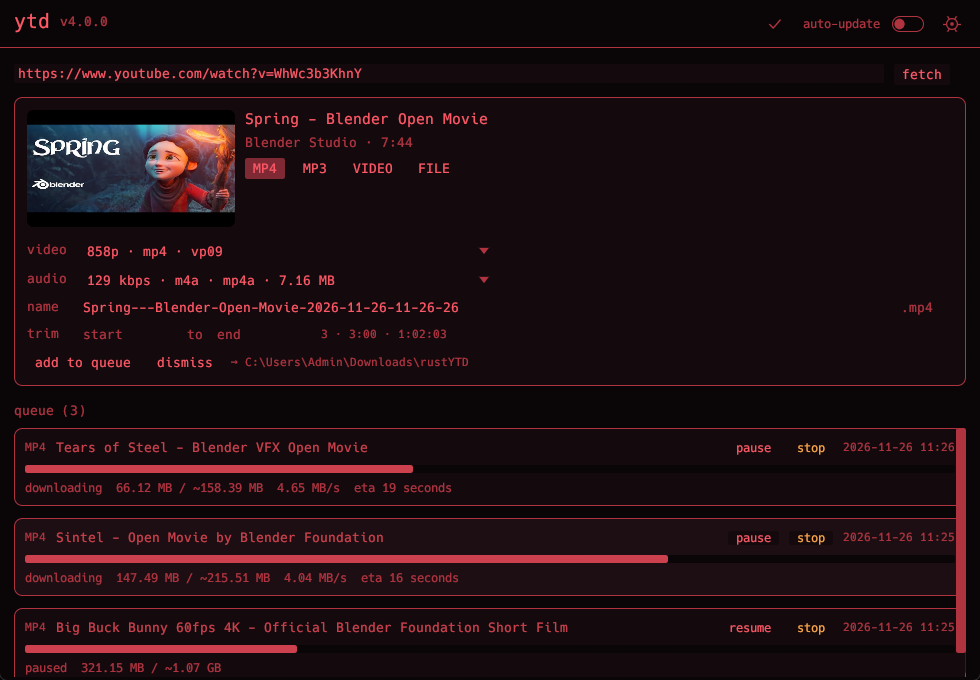
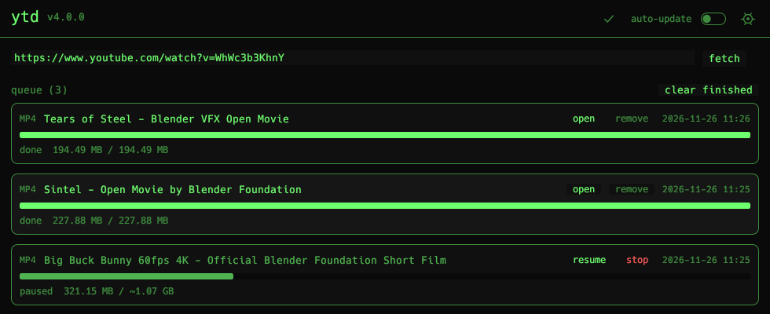
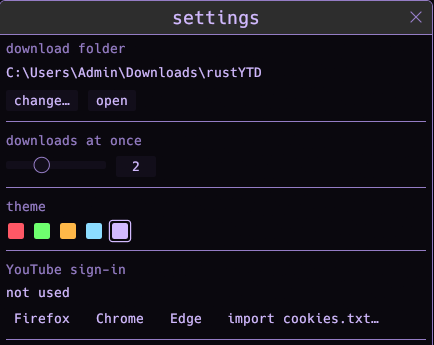
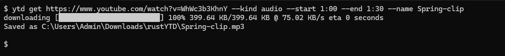

# rustYTD

Desktop video downloader with a GUI and a CLI, built on [yt-dlp](https://github.com/yt-dlp/yt-dlp) and [ffmpeg](https://ffmpeg.org). Paste a link, see a preview, pick what you want, and follow the download queue.

Windows, macOS and Linux.

**rustYTD gui**



<table>
   <tr>
   <th>
      queue (phosphor theme)
   </th>
   <th>
      settings
   </th>
   </tr>
   <tr>
   <td>
      
   </td>
   <td>
      
   </td>
   </tr>
   <tr>
   <th colspan="2">
      rustYTD cli
   </th>
   </tr>
   <tr>
   <td colspan="2">
      
   </td>
   </tr>
</table>

Screenshots use Blender Studio's open movies (Creative Commons).

## Prerequisite

- **Nothing to install on Windows and Linux.** On first run ytd downloads yt-dlp, ffmpeg and deno (the JavaScript runtime yt-dlp uses for YouTube) into its own folder. Each file is checked against its publisher's SHA-256 checksums.
- **macOS:** ffmpeg is not auto-installed. Run `brew install ffmpeg`. yt-dlp and deno are fetched automatically.
- **Building from source:** Rust 1.85 or newer.

## Download

Get the build for your system from the [latest release](https://github.com/danted4/rustYTD/releases/latest):

| System | GUI | CLI |
|---|---|---|
| Windows (x64) | `ytd-gui-x86_64-pc-windows-msvc.exe` | `ytd-x86_64-pc-windows-msvc.exe` |
| macOS (Apple silicon) | `ytd-gui-aarch64-apple-darwin.app.zip` | `ytd-aarch64-apple-darwin` |
| macOS (Intel) | `ytd-gui-x86_64-apple-darwin.app.zip` | `ytd-x86_64-apple-darwin` |
| Linux (x64) | `ytd-gui-x86_64-unknown-linux-gnu` | `ytd-x86_64-unknown-linux-gnu` |

`SHA256SUMS` in each release lists the checksum of every file. The builds are not code-signed, so Windows SmartScreen and macOS Gatekeeper ask for confirmation the first time.

## GUI

1. Paste a video link and press Enter (or click **fetch**).
2. Check the preview: thumbnail, title, channel and duration.
3. Choose what to download:
   - **MP4**: video and audio merged into an mp4 (recommended)
   - **MP3**: audio only, converted to mp3
   - **VIDEO**: video only, no audio
   - **FILE**: a single stream that already has both (often lower quality)
4. Pick the quality, rename the file if you like, and optionally set trim start/end times.
5. Click **add to queue**.

Queue:

- Downloads run in parallel up to the limit in settings (default 2).
- **pause** keeps the partial file and **resume** continues from it. **stop** cancels and deletes the partial files.
- Click a title to open its folder. The list is saved between runs.

Top bar:

- A tick means the tools are ready.
- **auto-update** (off by default) keeps ytd and its tools current from GitHub Releases. App updates take effect the next time you start ytd. On macOS a new version is announced instead of installed.
- The cog opens settings: download folder, downloads at once, colour theme, tool versions and **update tools**.

### "Sign in to confirm you're not a bot"

YouTube sometimes asks a computer to prove it is not a bot, especially after a lot of downloading. ytd then shows **YouTube wants a signed-in browser**, listing the browsers installed on your computer:

- Pick the browser you use YouTube in. ytd reads that browser's YouTube cookies from its profile on disk (no browser window opens) and sends them only to YouTube: links to other sites never get them.
- Each choice is tested before it is saved. If it fails, ytd says why and what to do next (for example: close the browser, or that the browser encrypts its cookies).
- **import cookies.txt…** works with any browser: export youtube.com cookies in Netscape (cookies.txt) format with a cookies.txt browser extension and pick the file.
- Change it, or stop using it, in settings → **YouTube sign-in**.

Supported browsers: Firefox, Chrome, Edge, Brave, Opera, Vivaldi, Chromium, Safari and Whale. On Windows, Chromium-based browsers (Chrome, Edge…) may encrypt their cookies so that other apps cannot read them. Firefox or a cookies.txt file always work.

## CLI

```text
ytd                      interactive prompts (URL, type, quality, name, trim)
ytd get <url> [options]  download without prompts
ytd formats <url>        list the formats a video offers
ytd tools [status|install|update]
ytd cookies [status|browser <name>|file <path>|off]
```

`ytd cookies browser firefox` (or `file cookies.txt`) tests the browser's YouTube sign-in and, if it works, uses it from then on. For a single run, add `--cookies-from <browser>` or `--cookies <file>` to any command.

`ytd get` options:

| Option | Meaning |
|---|---|
| `--kind merged\|audio\|video\|single` | what to download (default `merged`) |
| `--video <id\|1080p\|best>` | video stream (default: best) |
| `--audio <id\|best>` | audio stream (default: best) |
| `--name <file>` | output name, extension optional |
| `--start <t>` `--end <t>` | trim, e.g. `3`, `3:00` or `1:02:03` |
| `--dir <folder>` | where to save |

Example: `ytd get https://www.youtube.com/watch?v=jNQXAC9IVRw --kind audio --start 3 --end 0:10`

Ctrl-C cancels a download and removes its partial files.

## Where things go

- **Downloads:** `Downloads/rustYTD` (change it in settings).
- **Unfinished downloads:** each one keeps its partial files in its own folder under `.ytd-parts` inside the download folder. Stop or remove deletes that folder only; finished files are never touched.
- **Settings, job list and tools:**
  - Windows: `%APPDATA%\ytd`
  - macOS: `~/Library/Application Support/ytd`
  - Linux: `~/.config/ytd`

## Build from source

```bash
cargo run                                  # CLI
cargo run --features gui --bin ytd-gui     # GUI
cargo test --all-features
```

On Linux the GUI needs `libgtk-3-dev libxkbcommon-dev libxcb-render0-dev libxcb-shape0-dev libxcb-xfixes0-dev`.

## Star History

[](https://star-history.com/#danted4/rustYTD&Date)
