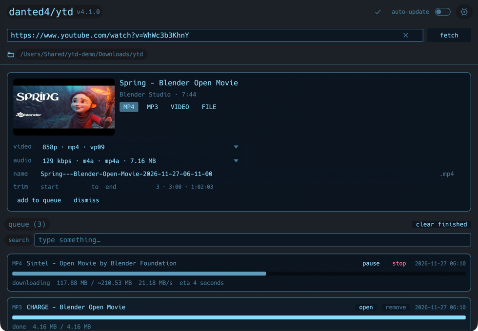
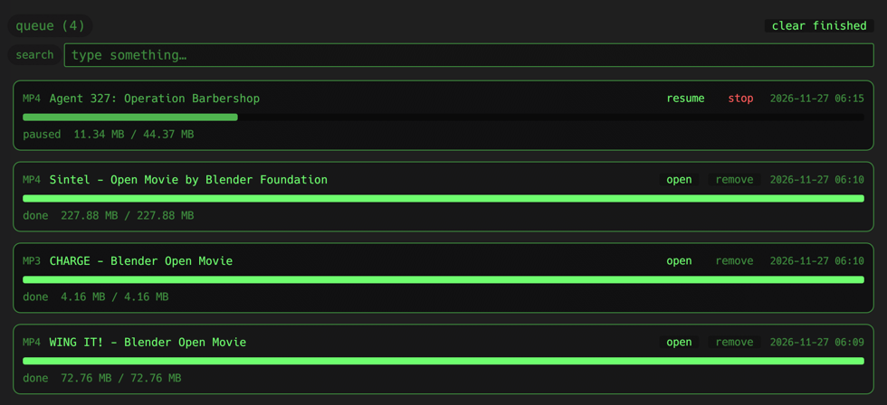
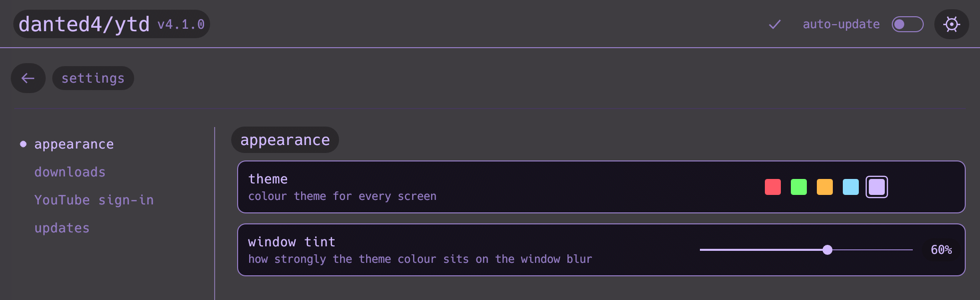
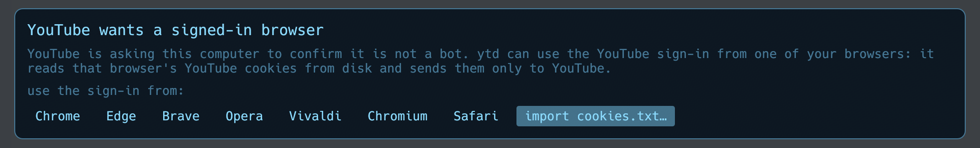
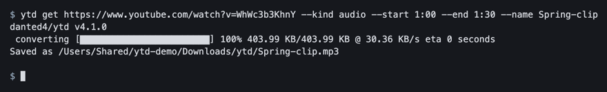

# ytd &nbsp;  &nbsp; <a href="#windows"></a> <a href="#macos"></a> <a href="#linux"></a>

Desktop video downloader with a GUI and a CLI, built on [yt-dlp](https://github.com/yt-dlp/yt-dlp) and [ffmpeg](https://ffmpeg.org). Paste a link, see a preview, pick what you want, and follow the download queue.

| Platform&nbsp;/&nbsp;system | How to get it | Notes |
|---|---|---|
| &nbsp;**[Windows](#windows)** | [Release](https://github.com/danted4/ytd/releases/latest): `ytd-gui-x86_64-pc-windows-msvc.exe` (GUI), `ytd-x86_64-pc-windows-msvc.exe` (CLI) | Windows 10/11, x64 |
| &nbsp;**[macOS](#macos)** | [Release](https://github.com/danted4/ytd/releases/latest): `ytd-gui-<arch>-apple-darwin.app.zip` (GUI), `ytd-<arch>-apple-darwin` (CLI); `aarch64` or `x86_64` | Apple silicon and Intel |
| &nbsp;**[Linux](#linux)** | [Release](https://github.com/danted4/ytd/releases/latest): `ytd-gui-x86_64-unknown-linux-gnu` (GUI), `ytd-x86_64-unknown-linux-gnu` (CLI) | x64; GUI needs GTK&nbsp;3 |

**ytd gui**



<table>
   <tr>
   <th>
      queue (phosphor theme)
   </th>
   </tr>
   <tr>
   <td>
      
   </td>
   </tr>
   <tr>
   <th>
      settings (violet theme)
   </th>
   </tr>
   <tr>
   <td>
      
   </td>
   </tr>
   <tr>
   <th>
      youtube sign-in (when YouTube asks to confirm you're not a bot)
   </th>
   </tr>
   <tr>
   <td>
      
   </td>
   </tr>
   <tr>
   <th>
      ytd cli
   </th>
   </tr>
   <tr>
   <td>
      
   </td>
   </tr>
</table>

Screenshots use Blender Studio's open movies (Creative Commons).

## Prerequisite

- **Nothing to install.** On first run ytd downloads yt-dlp, ffmpeg and deno (the JavaScript runtime yt-dlp uses for YouTube) into its own folder. Each file is checked against its publisher's SHA-256 checksums.
- **macOS:** ffmpeg comes from ytd's own static build ([danted4/ffmpeg-macos](https://github.com/danted4/ffmpeg-macos), GPL), installed only when no ffmpeg is found. If you already have one (for example from `brew install ffmpeg`), ytd uses it and installs nothing. Once ytd has installed its own, that one is used and kept up to date.

## Windows

1. Open the [latest release](https://github.com/danted4/ytd/releases/latest).
2. Download the GUI and/or the CLI:
   - GUI: `ytd-gui-x86_64-pc-windows-msvc.exe`
   - CLI: `ytd-x86_64-pc-windows-msvc.exe`
3. Double-click the GUI `.exe`, or run the CLI from PowerShell or Command Prompt.

> [!IMPORTANT]
> Windows SmartScreen often shows **Windows protected your PC**, because the builds are not code-signed. The `.exe` did not fail; SmartScreen stopped it.
>
> | ⚠️ | Do this or the app **never starts** |
> |---:|:---|
> | 1️⃣ | Click **More info** |
> | 2️⃣ | Click **Run anyway** |

If Explorer still blocks the file: right-click it → **Properties** → tick **Unblock** → **OK**, and run it again.

## macOS

1. Open the [latest release](https://github.com/danted4/ytd/releases/latest) and download the files for your Mac (Apple silicon `aarch64`, Intel `x86_64`):
   - GUI: `ytd-gui-<arch>-apple-darwin.app.zip`, or the plain binary `ytd-gui-<arch>-apple-darwin`
   - CLI: `ytd-<arch>-apple-darwin`
2. **GUI:** double-click the `.app.zip` to unzip **`ytd.app`** and drag it to **Applications**. The builds are not signed, so clear the quarantine flag GitHub downloads get:

   ```bash
   xattr -dr com.apple.quarantine /Applications/ytd.app
   open /Applications/ytd.app
   ```

   If macOS still blocks it ("Apple cannot check it for malicious software"): right-click **ytd** → **Open** → **Open**, or go to **System Settings → Privacy & Security** → **Open Anyway**.

3. **CLI** (or the plain GUI binary):

   ```bash
   chmod +x ytd-aarch64-apple-darwin
   xattr -d com.apple.quarantine ytd-aarch64-apple-darwin
   ./ytd-aarch64-apple-darwin
   ```

With auto-update on, `ytd.app` updates itself in place from 4.1.2 on (it replaces its binary, stamps the new version and signs the app again). Versions up to 4.1.1 only announce a new version: install 4.1.2 by hand once.

## Linux

1. Open the [latest release](https://github.com/danted4/ytd/releases/latest).
2. Download the GUI and/or the CLI:
   - GUI: `ytd-gui-x86_64-unknown-linux-gnu`
   - CLI: `ytd-x86_64-unknown-linux-gnu`
3. Make them executable:

   ```bash
   chmod +x ytd-gui-x86_64-unknown-linux-gnu ytd-x86_64-unknown-linux-gnu
   ```

4. **GUI only:** install GTK 3 and the xcb libraries. On Debian/Ubuntu:

   ```bash
   sudo apt install libgtk-3-0 libxkbcommon0 libxcb-render0 libxcb-shape0 libxcb-xfixes0
   ```

   The CLI does not need these.

5. Run `./ytd-gui-x86_64-unknown-linux-gnu` or `./ytd-x86_64-unknown-linux-gnu`.

### Checksums

`SHA256SUMS` in each release lists the checksum of every file. No Rust is needed to run ytd; building from source is under [Build from source](#build-from-source).

## GUI

1. Paste a video link and press Enter (or click **fetch**).
2. Check the preview: thumbnail, title, channel and duration.
3. Choose what to download:
   - **MP4**: video and audio merged into an mp4 (recommended)
   - **MP3**: audio only, converted to mp3
   - **VIDEO**: video only, no audio
   - **FILE**: a single stream that already has both (often lower quality)
4. Pick the quality, rename the file if you like, and optionally set trim start/end times.
5. Click **add to queue**, or **dismiss** to drop the preview and the link.

The **×** at the end of the link box (or Esc) clears it and starts over, even while a preview is still loading.

The folder under the link box is where downloads go. Click it to choose another one. Downloads already in the queue keep their folder.

Queue:

- Downloads run in parallel up to the limit in settings (default 2).
- A new download shows **starting** with a sliding bar while yt-dlp reads the video page, then **downloading** with its progress. A trimmed download has no size until it ends, so its bar keeps sliding. **merging** and **converting** show while ffmpeg finishes the file.
- **pause** keeps the partial file and **resume** continues from it. **stop** cancels and deletes the partial files.
- **search** filters the list by title, link, folder, type, date or status. Esc clears it.
- Click a title to open its folder. The list is saved between runs.

Top bar:

- A tick means the tools are ready.
- **auto-update** (off by default) keeps ytd and its tools current from GitHub Releases. A new version downloads with a progress toast, then a banner offers **restart now** (running downloads are paused and come back paused) or **later** (it runs from the next start).
- The cog opens the settings page; the title goes back to the downloads. Settings has four tabs:
  - **appearance**: colour theme, and on macOS the **window tint** (how strongly the theme colour sits on the frosted window; locked at 100% in fullscreen)
  - **downloads**: downloads at once
  - **YouTube sign-in**: see below
  - **updates**: auto-update, tool versions, **update tools** and **open tools folder**. **update tools** asks GitHub when you press it and downloads only the tools that are missing (a missing ffprobe counts) or behind their latest release; otherwise it says they are up to date. On Windows and Linux, ffmpeg counts as behind once its build is 30 days old, because its publisher releases a new one every day. To repair a tool that is damaged, delete it in **open tools folder** and press **update tools**, or run `ytd tools update --force`.

On macOS the window is frosted glass, as in torrenter. Windows and Linux stay opaque.

### "Sign in to confirm you're not a bot"

YouTube sometimes asks a computer to prove it is not a bot, especially after a lot of downloading. ytd then shows **YouTube wants a signed-in browser**, listing the browsers installed on your computer:

- Pick the browser you use YouTube in. ytd reads that browser's YouTube cookies from its profile on disk (no browser window opens) and sends them only to YouTube: links to other sites never get them.
- Each choice is tested before it is saved. If it fails, ytd says why and what to do next (for example: close the browser, or that the browser encrypts its cookies).
- **import cookies.txt…** works with any browser: export youtube.com cookies in Netscape (cookies.txt) format with a cookies.txt browser extension and pick the file.
- Change it, or stop using it, in settings → **YouTube sign-in**.

Supported browsers: Firefox, Chrome, Edge, Brave, Opera, Vivaldi, Chromium, Safari and Whale. On Windows, Chromium-based browsers (Chrome, Edge…) may encrypt their cookies so that other apps cannot read them. Firefox or a cookies.txt file always work.

## CLI

```text
ytd                      interactive prompts (URL, type, quality, name, trim)
ytd get <url> [options]  download without prompts
ytd formats <url>        list the formats a video offers
ytd tools [status|install|update [--force]]
ytd cookies [status|browser <name>|file <path>|off]
```

`ytd tools update` downloads only the tools that are behind their latest release; `--force` re-installs all of them.

`ytd cookies browser firefox` (or `file cookies.txt`) tests the browser's YouTube sign-in and, if it works, uses it from then on. For a single run, add `--cookies-from <browser>` or `--cookies <file>` to any command.

`ytd get` options:

| Option | Meaning |
|---|---|
| `--kind merged\|audio\|video\|single` | what to download (default `merged`) |
| `--video <id\|1080p\|best>` | video stream (default: best) |
| `--audio <id\|best>` | audio stream (default: best) |
| `--name <file>` | output name, extension optional |
| `--start <t>` `--end <t>` | trim, e.g. `3`, `3:00` or `1:02:03` |
| `--dir <folder>` | where to save |

Example: `ytd get https://www.youtube.com/watch?v=jNQXAC9IVRw --kind audio --start 3 --end 0:10`

Ctrl-C cancels a download and removes its partial files.

## Where things go

- **Downloads:** `Downloads/ytd`, or `Downloads/ytd-downloads` when a file named `ytd` (such as the CLI) is already there. Change it with the folder under the link box, or `--dir` in the CLI.
- **Unfinished downloads:** each one keeps its partial files in its own folder under `.ytd-parts` inside the download folder. Stop or remove deletes that folder only; finished files are never touched.
- **Settings, job list and tools:**
  - Windows: `%APPDATA%\ytd`
  - macOS: `~/Library/Application Support/ytd`
  - Linux: `~/.config/ytd`

## Build from source

Needs Rust 1.85 or newer.

```bash
cargo run                                  # CLI
cargo run --features gui --bin ytd-gui     # GUI
cargo test --all-features
```

On Linux the GUI needs `libgtk-3-dev libxkbcommon-dev libxcb-render0-dev libxcb-shape0-dev libxcb-xfixes0-dev`.

## Responsible use

ytd is a general-purpose tool built on yt-dlp. Download only what you have the right to download: your own uploads, videos under a licence that allows it (such as Creative Commons), or content the rights holder lets you save.

- Saving a video for personal offline viewing can still go against a site's terms. YouTube's terms, for example, only allow downloads where YouTube offers a download button or link. Copyright law also differs from country to country, so check what applies where you live.
- Don't use ytd to redistribute, re-upload or sell other people's content, or to get around paywalls. It does not decrypt DRM-protected media.
- YouTube sign-in sends your own browser's YouTube cookies, so downloads are made as your account and YouTube's terms apply to that account.

ytd is not affiliated with YouTube, Google, yt-dlp, FFmpeg or Deno. It is provided as is, without warranty, and its authors are not liable for how it is used; see the [license](LICENSE).

## License

[ISC](LICENSE)

## Star History

[](https://star-history.com/#danted4/ytd&Date)
